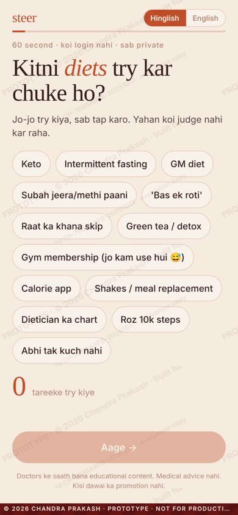
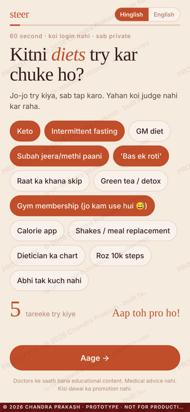
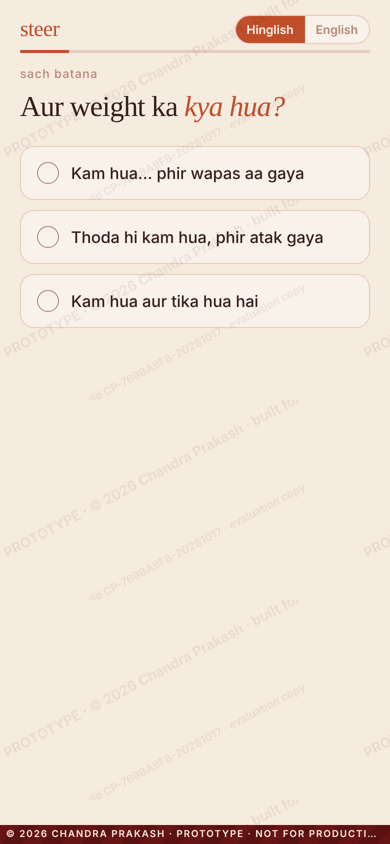
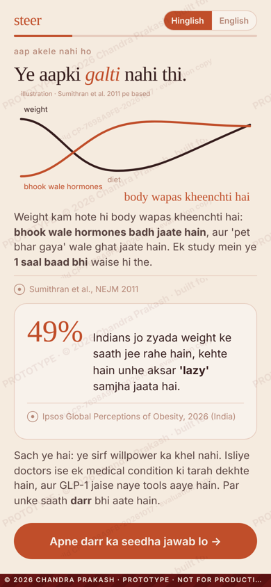
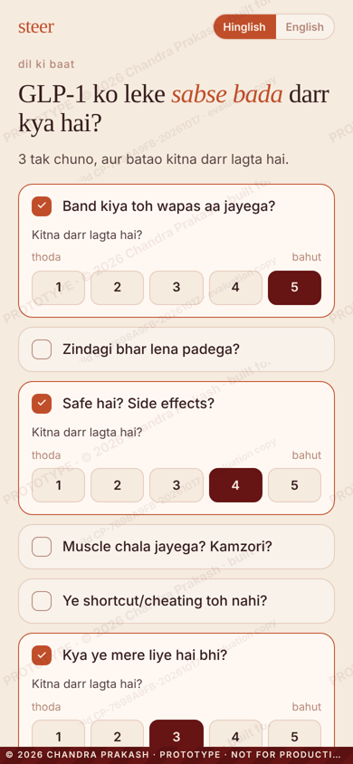
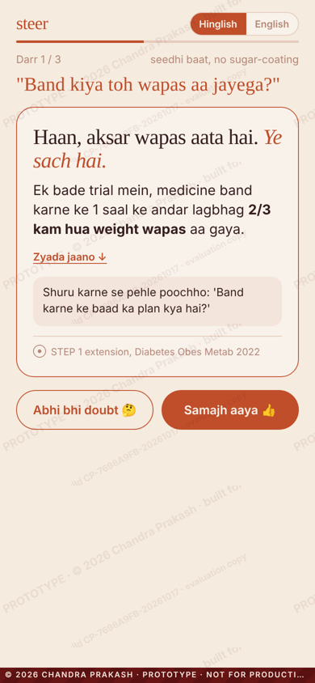
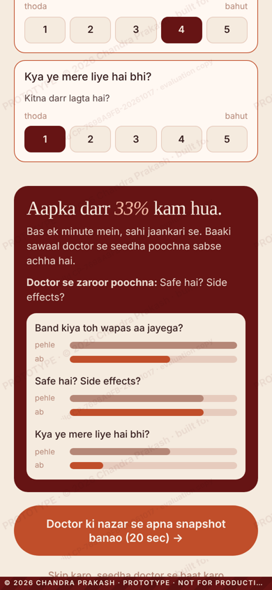
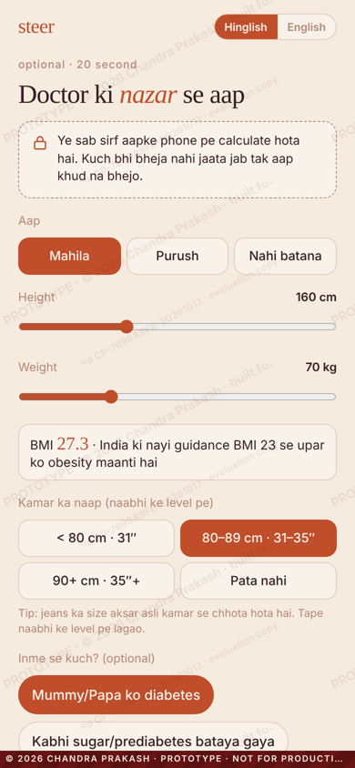
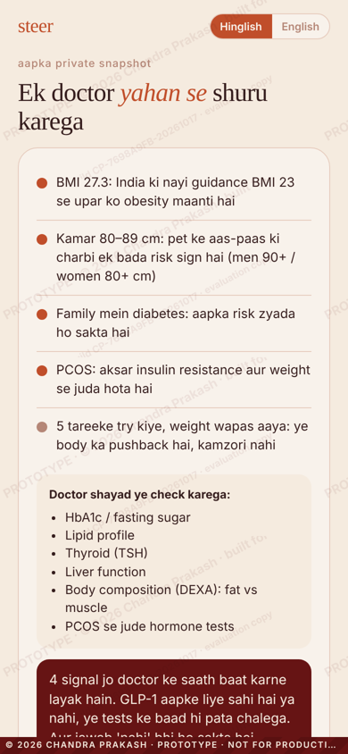
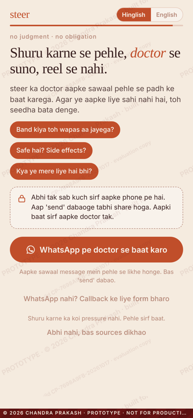

# Walkthrough: one full play (about 90 s)

© 2026 Chandra Prakash · screens captured from `index.html` at 390×844 (phone)

| # | Screen | What happens | Why |
|---|---|---|---|
| 1 |  | **Hook:** "Kitni diets try kar chuke ho?" | An identity question everyone can answer. No wrong answer, no judgment. |
| 2 |  | User taps 5 diets. The counter reads *"Aap toh pro ho!"* | Fun and personal. It's a mirror, not a sales pitch. |
| 3 |  | "Aur weight ka kya hua?" The user picks *"wapas aa gaya"*. | Captures their real story for the doctor. |
| 4 |  | **Relief:** "Ye aapki galti nahi thi." A hunger-hormone chart (NEJM 2011) and Ipsos 49% "lazy" stigma data. | Removes shame before any information is given. |
| 5 |  | User picks their top 3 GLP-1 fears from 7 and rates each one 1–5. | The answers are about *their* worries, not a generic FAQ. |
| 6 |  | **Honest answer:** "Haan, aksar wapas aata hai. Ye sach hai." STEP 1: about 2/3 regained within a year. Followed by a "question to ask your doctor". | Two-sided answers build trust with sceptics. Each card shows its source. |
| 7 |  | The user re-rates each fear and sees before/after bars: **"Aapka darr 33% kam hua."** | Value you can measure. Fears still unsure become the first thing the doctor discusses. |
| 8 |  | Optional 20 s snapshot: sex, height/weight sliders, waist, family diabetes, PCOS. | Private: nothing leaves the phone until the user taps send. |
| 9 |  | **Doctor's-eye snapshot** using India's cut-offs (BMI >23, waist 80/90 cm), plus the tests a doctor would order. | Personal and honest. It can say "medicine may not be needed". |
| 10 |  | **Handoff:** "WhatsApp pe doctor se baat karo", pre-filled with the user's fears and snapshot. There's also a callback form and a "just show sources" exit. | One low-pressure, private next step. The care team gets a warm lead plus a suggested opener (view it with `?debug=1`). |

**Try also:**
- `?hook=4pm` for hook B ("4 baje phir se bhookh kyun lagti hai?")
- `?lang=en` for English
- `?debug=1` for the live lead record
